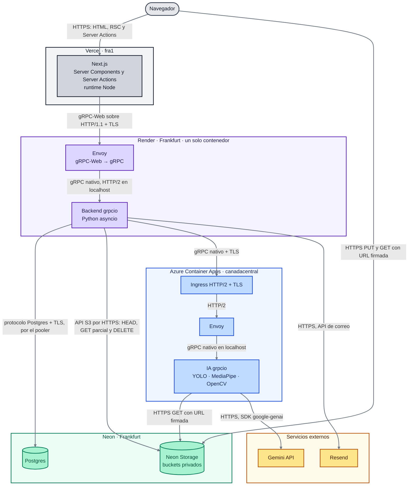
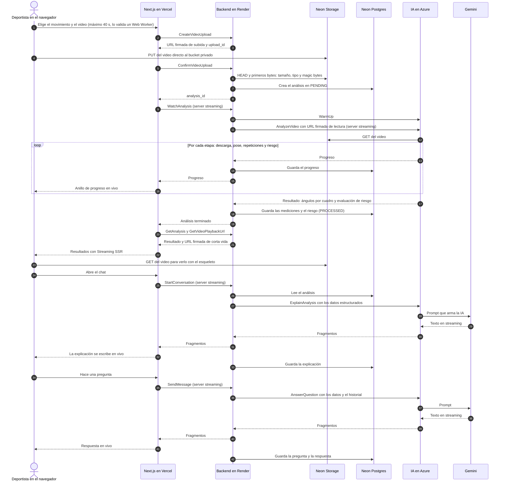
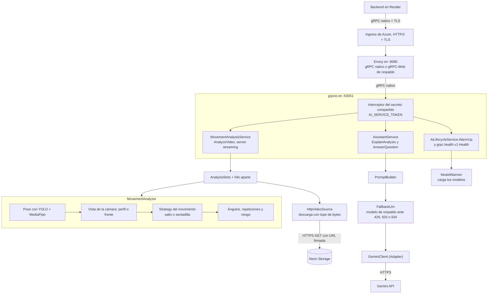

# KinesiApp IA

La app está publicada en **https://www.kinesiapp.com**.

Es el microservicio de inteligencia artificial de KinesiApp, un servidor gRPC asíncrono en Python. Hace dos cosas:

- **Analiza el movimiento.** Descarga el video del bucket, detecta a la persona con YOLO y estima la pose con MediaPipe. Después detecto automáticamente desde dónde se grabó (`analysis/camera_view.py`): comparo el ancho aparente de hombros y caderas con el alto del torso, en la mediana de todo el video.
  - **De perfil**, calculo los ángulos de rodilla y tronco por repetición.
  - **De frente**, mido el valgo de cada rodilla (cuánto se va hacia adentro) y la asimetría entre las dos.
  - Si la vista no es clara, la marco como inconclusa y la analizo como de perfil.

  En todos los casos devuelvo un puntaje de riesgo con su desglose, y la vista detectada va en `risk_assessment.camera_view`.
- **Explica el resultado.** Arma el prompt con los datos estructurados que le manda el backend y responde con Gemini en streaming.

Solo lo llama el backend. El frontend nunca habla con la IA.

## Arquitectura de KinesiApp

KinesiApp son cuatro repos que se hablan solo por RPC definidos en [KinesiApp-Contracts](https://github.com/solartedaniers/KinesiApp-Contracts), sin API REST. Este diagrama y el de secuencia son los mismos en los cuatro README; cada flecha dice su protocolo.



### Flujo principal: subir un video, analizarlo, ver el resultado y preguntar al chat



### Qué hace cada parte

- **Navegador.** Ahí la persona graba o elige el video. Valido la duración en un Web Worker y subo el archivo directo al bucket con una URL firmada, así el video nunca pasa por Vercel. El navegador no habla gRPC ni conoce la URL del backend.
- **Next.js en Vercel.** Sirve las páginas con el patrón que le toca a cada una (SSG, ISR, SSR con streaming y CSR) y, desde los Server Components y las Server Actions, llama al backend con un cliente gRPC-Web generado del contrato. Guarda la sesión en cookies `httpOnly`.
- **Envoy en Render.** Render solo acepta HTTP/1.1 desde internet, así que Envoy recibe gRPC-Web y lo traduce a gRPC nativo hacia grpcio, en el mismo contenedor. Solo deja pasar las rutas del contrato.
- **Backend grpcio en Render.** Es el dueño de los datos y de las reglas: cuentas, roles, deportistas, equipos, análisis y chat. Verifica el token en un interceptor, guarda en Postgres, firma las URLs de los archivos y le encarga el trabajo pesado a la IA.
- **IA en Azure Container Apps.** Es un microservicio gRPC propio. Analiza el video con YOLO, MediaPipe y OpenCV y devuelve en streaming el progreso, los ángulos y el riesgo. También arma el prompt del chat y habla con Gemini. Baja a cero réplicas cuando nadie la usa, por eso el backend la despierta con `WarmUp`.
- **Neon Postgres.** Guarda las cuentas, los perfiles, los equipos, los análisis con sus mediciones y los mensajes del chat. Está en Frankfurt, junto al backend, para que cada consulta tarde poco.
- **Neon Storage.** Son buckets privados compatibles con S3 para los videos, las fotos y los logos. Solo se entra con URLs firmadas de corta vida.
- **Gemini.** Es el modelo de lenguaje que redacta la explicación del análisis y responde las preguntas. Solo lo llama la IA.
- **Resend.** Envía desde `no-reply@kinesiapp.com` los correos con el código de verificación y el de recuperación de contraseña.

## Arquitectura de este repo



- **Contract-first.** Implemento el paquete `kinesiapp.ai.v1` de [KinesiApp-Contracts](https://github.com/solartedaniers/KinesiApp-Contracts), que traigo como submódulo en `contracts/` fijado a un tag. `scripts/generate_grpc.py` genera `generated/`, que no se versiona.
- **Servicios** (`src/kinesiapp_ai/rpc/`):
  - `MovementAnalysisService.AnalyzeVideo`: server streaming. Emite el progreso por etapas (descarga, pose, repeticiones, riesgo) y al final el resultado con las muestras de ángulos y el `RiskAssessment`.
  - `AssistantService.ExplainAnalysis` y `AnswerQuestion`: server streaming del texto de Gemini.
  - `AiLifecycleService.WarmUp`: carga los modelos y responde cuando la IA está lista. Además expongo el estándar `grpc.health.v1.Health`.
- **Seguridad.**
  - Un interceptor exige el secreto compartido `AI_SERVICE_TOKEN` en `authorization: Bearer` y lo compara en tiempo constante.
  - Solo descargo videos de los hosts de `VIDEO_DOWNLOAD_ALLOWED_HOSTS`, con tope de bytes, de redirecciones y de tiempo.
  - Los errores salen con el status estándar de gRPC y `google.rpc.ErrorInfo`, igual que en el backend.
- **Diseño del análisis.**
  - Cada movimiento es una *Strategy* (`movement_strategy.py`): el salto detecta repeticiones por aterrizaje, y la sentadilla por el fondo de la rodilla o la bisagra del tronco.
  - Las arma una *Factory* (`pipeline/strategy_factory.py`).
  - `MovementAnalyzer` encadena la extracción de pose, el preprocesado, los ángulos y el riesgo.
  - El trabajo pesado corre en un hilo aparte (`threaded_analysis.py`) para no frenar el event loop de gRPC, con un tope de análisis simultáneos (`AnalysisSlots`).
- **Chat.**
  - `chat/prompt_builder.py` arma el prompt a partir de los datos estructurados del análisis y el historial.
  - `chat/gemini_client.py` es el *Adapter* de Gemini.
  - `chat/fallback_llm.py` recurre a un modelo de respaldo una sola vez si el principal da 429, 503 o 504, o si se queda callado antes del primer texto.

Los umbrales de riesgo son placeholders de orden de magnitud tomados del spike, **sin validación clínica**. Viven en `settings/risk.py` y se pueden ajustar por variable de entorno.

## Requisitos

- **Python 3.12**, la misma versión de la imagen (`python:3.12-slim`).
- **Git** con submódulos, porque los contratos llegan en `contracts/`.
- **curl**, para bajar los dos modelos la primera vez.
- **Docker** (uso Docker Desktop 29.4), solo si quiero correr el contenedor con Envoy como en Azure.
- **Azure CLI** (`az`), solo para desplegar una imagen nueva.

## Configuración

Toda la configuración está en `src/kinesiapp_ai/settings/`, como clases de `pydantic-settings` por dominio. `AI_SERVICE_TOKEN`, `GEMINI_API_KEY` y `VIDEO_DOWNLOAD_ALLOWED_HOSTS` no tienen default: sin ellas la IA no arranca. Copio `.env.example` a `.env` y lo lleno así. El `.env` nunca va al repo.

| Variable | Para qué la uso | De dónde saco el valor | Secreta |
|---|---|---|---|
| `AI_SERVICE_TOKEN` | El secreto compartido con el backend, de 32 caracteres o más. El backend lo manda en `authorization: Bearer` y yo lo comparo en tiempo constante. | Lo genero con `python -c "import secrets; print(secrets.token_urlsafe(48))"` y pongo el mismo en el backend | **Sí** |
| `GEMINI_API_KEY` | La clave con la que llamo a Gemini para explicar el análisis y responder el chat. | Google AI Studio → Get API key | **Sí** |
| `VIDEO_DOWNLOAD_ALLOWED_HOSTS` | Los únicos hosts desde los que descargo videos, en una lista JSON. Pongo solo el host del endpoint de Neon Storage, sin `https://`. Así nadie me hace descargar de otro lado. | Neon → Storage, el host del endpoint | No es secreta, pero no la publico |
| `VIDEO_DOWNLOAD_MAX_BYTES`, `VIDEO_DOWNLOAD_CONNECT_TIMEOUT_SECONDS`, `VIDEO_DOWNLOAD_TOTAL_TIMEOUT_SECONDS`, `VIDEO_DOWNLOAD_MAX_REDIRECTS` | Los topes de la descarga: 100 MB, 10 s para conectar, 120 s en total y 3 redirecciones. | Default | No |
| `GRPC_HOST`, `GRPC_PORT`, `GRPC_SHUTDOWN_GRACE_SECONDS` | Dónde escucha `grpcio` (`127.0.0.1:50051`) y cuánto dejo terminar las llamadas al apagar. Solo Envoy queda expuesto. | Default | No |
| `PORT`, `ENVOY_CONNECT_TIMEOUT` | Solo los lee `deploy/entrypoint.sh`: el puerto público de Envoy (8080) y lo que espera para conectar con `grpcio`. No van en el `.env`. | Default | No |
| `ANALYSIS_MAX_CONCURRENCY` | Cuántos análisis corro a la vez. Uso 1 porque la réplica de Azure tiene 1 vCPU y 2 GiB. | Default | No |
| `ANALYSIS_MAX_VIDEO_DURATION_SECONDS` | El tope de duración del video, 40 s, el mismo del backend. | Default | No |
| `ANALYSIS_MAX_FRAME_SIDE_PX` | El lado mayor al que reduzco cada frame; vacío analiza a la resolución original. Recomiendo 720: con un video de 1080×1920, el pico de memoria baja de 451 a 417 MiB y el resultado es idéntico. | Lo decido yo | No |
| `ANALYSIS_MAX_FPS` | Un tope de frames por segundo; vacío usa todos. Bajarlo cambia los puntajes. | Lo decido yo | No |
| `ANALYSIS_PROGRESS_EVERY_FRAMES` | Cada cuántos frames emito progreso por el stream. | Default (10) | No |
| `PERSON_DETECTOR_INTERVAL_FRAMES` | Cada cuántos frames corro YOLO. Entre medias sostengo el recorte de la persona. | Default (1) | No |
| `PERSON_DETECTOR_THREADS` | Los hilos de YOLO; vacío usa uno por núcleo. En Render, con 0.1 de CPU, 1 hilo rendía mucho más. | Lo decido yo | No |
| `GEMINI_MODEL`, `GEMINI_FALLBACK_MODEL` | El modelo principal y el de respaldo, al que recurro una sola vez si el principal da 429, 503 o 504, o si se queda callado antes del primer texto. | Los elijo yo | No |
| `GEMINI_TIMEOUT_SECONDS`, `GEMINI_FIRST_TEXT_TIMEOUT_SECONDS`, `GEMINI_MAX_OUTPUT_TOKENS` | El plazo de la respuesta (30 s), lo que espero el primer texto (6 s) y el tope de salida (1024 tokens). | Default | No |
| `GEMINI_THINKING_LEVEL` | Cuánto razona el modelo. Con el nivel por defecto del modelo, gastaba casi toda la salida pensando y la respuesta quedaba truncada. | Default (`MINIMAL`) | No |
| `CHAT_QUESTION_MAX_CHARS`, `CHAT_HISTORY_MAX_MESSAGES`, `CHAT_PROMPT_MAX_REPETITIONS` | El largo de la pregunta y cuánto historial y cuántas repeticiones meto en el prompt. | Default | No |

Los umbrales de pose, de detección de repeticiones y de riesgo (`POSE_*`, `PERSON_*`, `JUMP_*`, `SQUAT_*`, `RISK_*`) también se pueden cambiar por variable de entorno. No van en `.env.example` porque sus defaults salen del spike y viven en `settings/pose.py`, `settings/phases.py` y `settings/risk.py`.

## Cómo correrlo

```bash
git clone --recurse-submodules https://github.com/solartedaniers/KinesiApp_IA.git
cd KinesiApp_IA
python -m venv .venv && .venv/Scripts/pip install -e ".[test,codegen]"   # en Linux/macOS: .venv/bin/pip
python scripts/generate_grpc.py
# Modelos (el Dockerfile los descarga fijados por checksum)
curl -L -o models/pose_landmarker_full.task https://storage.googleapis.com/mediapipe-models/pose_landmarker/pose_landmarker_full/float16/1/pose_landmarker_full.task
curl -L -o models/yolo11n.onnx https://github.com/ultralytics/assets/releases/download/v8.3.0/yolo11n.onnx
cp .env.example .env              # y lo lleno con la tabla de Configuración
PYTHONPATH=src:generated python -m kinesiapp_ai.rpc.server
```

O el contenedor completo, como en Azure:

```bash
docker build -t kinesiapp-ai .
docker run --rm --env-file .env -p 8080:8080 kinesiapp-ai
```

## Pruebas

```bash
pytest
```

Las pruebas no llaman a Gemini: usan dobles del modelo de lenguaje. Las de pose usan series sintéticas (`tests/pose_fixtures.py`). Las que necesitan los videos reales del spike o los modelos descargados se saltan si no los encuentran.

## Errores comunes

| Lo que veo | Por qué pasa | Cómo lo arreglo |
|---|---|---|
| `contracts/` está vacío o `generate_grpc.py` no encuentra los `.proto` | Cloné sin `--recurse-submodules`. | `git submodule update --init` y vuelvo a generar. |
| `ModuleNotFoundError` de `kinesiapp_ai` o de `kinesiapp` | Falta el path del código o el generado. | `PYTHONPATH=src:generated`. En PowerShell es `$env:PYTHONPATH="src;generated"`, porque en Windows el separador es `;`. |
| La IA no arranca porque no encuentra `models/pose_landmarker_full.task` o `models/yolo11n.onnx` | Los modelos no van en el repo. | Los bajo con los dos `curl` de "Cómo correrlo". La imagen los descarga sola, con checksum. |
| No arranca con un `ValidationError` de pydantic | Falta `AI_SERVICE_TOKEN` o tiene menos de 32 caracteres; falta `GEMINI_API_KEY`; o `VIDEO_DOWNLOAD_ALLOWED_HOSTS` no es JSON válido. | Lleno la variable que dice el error. Los hosts van como `["host"]`, con comillas dobles. |
| `UNAUTHENTICATED` en cada llamada | El `AI_SERVICE_TOKEN` del backend no es el mismo que el mío. | Pongo el mismo valor en Render y en los secretos de Container Apps. |
| `INVALID_ARGUMENT` con "Video host is not allowed" | El video viene de un host que no está en `VIDEO_DOWNLOAD_ALLOWED_HOSTS`, por ejemplo después de cambiar el endpoint de Neon Storage. | Agrego ese host, sin `https://`. |
| `INTERNAL` con `RST_STREAM` a los ~40 s | El ingress de Azure corta el stream de `AnalyzeVideo` cuando esa llamada es la que despierta la réplica. | El backend llama a `WarmUp` antes de analizar. Si llamo a mano, primero despierto la IA con `WarmUp`. |
| Gemini responde 429 | Se acabó la cuota gratuita. | Recurro una vez al modelo de respaldo. Si también falla, espero a que se renueve la cuota. |
| La respuesta del chat sale cortada o tarda en empezar | El modelo gasta la salida razonando. | Dejo `GEMINI_THINKING_LEVEL=MINIMAL` o `LOW`. |
| La memoria se dispara con videos de 1080p en una máquina chica | Analizo los frames a la resolución original. | `ANALYSIS_MAX_FRAME_SIDE_PX=720`, que da el mismo resultado. |
| Hice push y Azure sigue con la versión vieja | El push solo construye la imagen; Azure no la toma sola. | Corro `az containerapp update` con la imagen nueva (ver "Flujo de trabajo"). |

## Flujo de trabajo

- **Trabajo en ramas feature.** Aquí es `feature/grpc-ai`. Nunca hago commit directo en `main`; fusiono con `--no-ff` cuando el cambio está probado.
- **El push a `main` despliega a producción** el backend (Render) y el frontend (Vercel), cada uno desde su repo.
- **La IA necesita el `az containerapp update`.** El push a `main` o a `feature/grpc-ai` que toque el código construye y publica `ghcr.io/solartedaniers/kinesiapp-ai:<sha>`. Azure sigue en su revisión hasta que corro:
  ```bash
  az containerapp update -n kinesiapp-ia -g kinesiapp-rg --image ghcr.io/solartedaniers/kinesiapp-ai:<sha>
  ```
  Después reviso que la revisión nueva quede sana y que `WarmUp` responda.
- **Las migraciones se corren a mano** desde el backend, con Alembic. La IA no tiene base.
- **Las previews usan la base real.** Los previews del frontend hablan con el backend de producción y, a través de él, con esta IA de producción. Lo que se analiza en un preview gasta cuota de Gemini y queda en la base real.
- **Contract-first.** Si cambia un RPC de `kinesiapp.ai.v1`, primero va el contrato con un tag nuevo en KinesiApp-Contracts. Después muevo el submódulo y regenero.

## Producción

La app está publicada en **https://www.kinesiapp.com**.

| Servicio | Dónde corre | Cómo llega a producción |
|---|---|---|
| Frontend (Next.js) | Vercel, con las funciones en `fra1` (Fráncfort) | Push a `main`, automático |
| Backend (Envoy + `grpcio`) | Render en Frankfurt, como servicio Docker | Push a `main`, automático |
| IA (este repo) | Azure Container Apps en `canadacentral`, con 1 vCPU, 2 GiB y 0 a 1 réplica | `az containerapp update` con la imagen de GHCR |
| Base de datos | Neon Postgres en Frankfurt, branch `production` | Migraciones a mano con Alembic |
| Archivos | Neon Storage, buckets privados | — |
| Correo | Resend, desde `no-reply@kinesiapp.com` | — |

## Despliegue

- **Imagen.** GitHub Actions (`.github/workflows/image.yml`) construye la imagen en cada push a `main` o a `feature/grpc-ai` que toque el código, y la publica en GHCR como `ghcr.io/solartedaniers/kinesiapp-ai:<sha>`. No uso ACR.
- **Azure Container Apps.**
  - La app `kinesiapp-ia` vive en el grupo de recursos `kinesiapp-rg` (`canadacentral`), dentro del entorno `kinesiapp-env` con Workload Profiles, porque el modo Express no acepta HTTP/2.
  - Corre con 1 vCPU y 2 GiB, entre 0 y 1 réplica, cooldown de 300 s e ingress HTTP/2 con TLS.
  - `AI_SERVICE_TOKEN` y `GEMINI_API_KEY` viven solo como secretos de Container Apps.
  - Cada revisión apunta a una imagen inmutable por SHA. Producción corre la revisión `kinesiapp-ia--0000006`, con la imagen del commit de `main` `7dc09ed`. Para volver atrás se activa la revisión anterior con su imagen (`az containerapp update --image ...`).
- **Por qué no Render.** La CPU fraccionada del plan free (0.1) no daba los tiempos. En Azure, con 1 vCPU, un análisis de 40 s tarda 32–37 s y el arranque en frío unos 20–33 s.
- **Costos vigilados.** Hay un presupuesto mensual de 50 USD con avisos, y una alerta cuando el tiempo de réplicas pasa de unos 120 minutos en 6 h.
- **Memoria medida** con MediaPipe, OpenCV, onnxruntime y google-genai cargados: el pico es de 340–373 MB a 474×850 y de 451 MiB a 1080×1920 sin reducir. Lo medí pensando en los 512 MB de Render; en Azure la réplica tiene 2 GiB, así que sobra margen.
